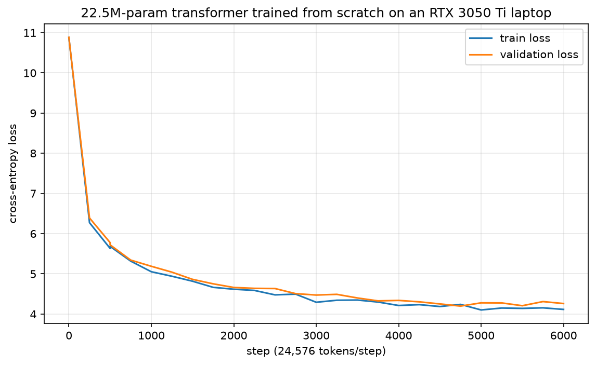

# Micro-LLM: 22.46M Parameter Transformer Trained From Scratch

A 22.46M-parameter auto-regressive language model built from scratch and pre-trained entirely on a consumer laptop equipped with an **NVIDIA GeForce RTX 3050 Ti Laptop GPU (4 GB VRAM)**.

This repository contains the model architecture, data streaming pipeline, training loop, loss metrics, and inference scripts.



---

## 1. Architecture Overview

The model is built with modern transformer components inspired by the LLaMA and OLMo architectures:

| Hyperparameter | Value | Description |
| :--- | :--- | :--- |
| **Total Parameters** | **22,455,072 (22.46M)** | Trainable parameters |
| **Active Transformer Backbone** | **~7.96M** | Layer parameters excluding embeddings |
| **Vocabulary Size** | 50,304 | GPT-2 BPE tokenizer (padded to multiple of 64) |
| **Hidden Dimension ($d_{\text{model}}$)** | 288 | Embedding & residual stream width |
| **Layers** | 8 | Transformer decoder blocks |
| **Attention Heads** | 6 | Multi-head attention (head dim = 48) |
| **Feed-Forward Dimension** | 768 | SwiGLU projection width |
| **Position Embeddings** | RoPE | Rotary Position Embeddings ($\theta = 10,000.0$) |
| **Normalization** | RMSNorm | Root Mean Square Normalization ($\epsilon = 10^{-5}$) |
| **Weight Tying** | Yes | Token embeddings shared with LM head |
| **Context Length** | 512 | Maximum sequence length |

---

## 2. Pre-Training Dataset

Data was streamed, tokenized with `tiktoken` (GPT-2 BPE encoding), and serialized into memory-mapped 16-bit binary files (`uint16`):

* **Dataset:** `HuggingFaceFW/fineweb-edu (sample-10BT)`
* **Training Tokens:** `148,507,609` tokens (`data_v2/train.bin`, 283.26 MB)
* **Validation Tokens:** `1,500,000` tokens (`data_v2/val.bin`, 2.86 MB)
* **Total Tokens Prepared:** `150,007,609` tokens

---

## 3. Training Configuration & Hardware

Pre-training was conducted locally on consumer hardware without cloud compute:

* **Hardware:** NVIDIA GeForce RTX 3050 Ti Laptop GPU (4 GB GDDR6 VRAM)
* **Precision:** Automatic Mixed Precision (PyTorch AMP `torch.float16`)
* **Micro-Batch Size:** 8 sequences
* **Sequence Length:** 512 tokens
* **Gradient Accumulation Steps:** 6
* **Effective Batch Size:** 48 sequences = **24,576 tokens per step**
* **Total Training Steps:** 6,000
* **Total Tokens Processed:** $6,000 \times 24,576 = \mathbf{147,456,000\text{ tokens}}$ (~1 pass over the 148.5M training split)
* **Optimizer:** AdamW ($\beta_1 = 0.9, \beta_2 = 0.95, \text{weight decay} = 0.1, \text{grad clip} = 1.0$)
* **Learning Rate Schedule:** Cosine decay with linear warmup (peak $\text{lr} = 6.0 \times 10^{-4}$, min $\text{lr} = 6.0 \times 10^{-5}$, warmup = 200 steps)
* **Peak VRAM Consumed:** **3.28 GB** (100% inside physical VRAM, 0% system RAM paging)
* **Throughput:** ~21,000 to ~30,000 tokens/second (~0.85s to 1.15s per step)

---

## 4. Training Results & Metrics

Metrics recorded in `checkpoints_v2/loss_log.csv`:

* **Initial Cross-Entropy Loss (Step 0):** `10.8801` (matches theoretical random guessing across 50,304 tokens: $-\ln(1/50304) \approx 10.8258$)
* **Initial Validation Loss:** `10.8833`
* **Best Validation Loss:** **`4.1976`** (recorded at Step 4,750)
* **Final Validation Loss (Step 6,000):** `4.2611`
* **Final Training Loss (Step 6,000):** `4.1151`

### Loss Progression Summary

| Step | Train Loss | Validation Loss | Learning Rate | Elapsed (Session) |
| :---: | :---: | :---: | :---: | :---: |
| 0 | 10.8801 | 10.8833 | 3.00e-06 | 0.0 min |
| 500 | 5.6834 | 5.7204 | 5.96e-04 | 1.8 min |
| 1000 | 5.0523 | 5.1882 | 5.75e-04 | 11.1 min |
| 2000 | 4.6176 | 4.6611 | 4.82e-04 | 29.8 min |
| 3000 | 4.2932 | 4.4728 | 3.45e-04 | 48.9 min |
| 4000 | 4.2126 | 4.3393 | 2.04e-04 | 67.9 min |
| 4750 | 4.2402 | **4.1976** | 1.20e-04 | 82.0 min |
| 6000 | 4.1151 | 4.2611 | 6.00e-05 | 105.8 min |

---

## 5. Sample Outputs

Unprompted completions generated from the final checkpoint (`checkpoints_v2/best_model.pt`) using greedy/top-k sampling:

**Prompt:** `"The secret to the universe is"`
> *"The secret to the universe is a small piece of the cosmos, and only a small piece of material is lost. The object in the universe is usually seen as a single object in an object. If it is a single object, the object itself must be the result of a space. The third element for the universe is the..."*

**Prompt:** `"Once upon a time, a young engineer"`
> *"Once upon a time, a young engineer can help to make sure that they be able to track the speed of the engine, so that the engine has a significant impact on the engine and its engine..."*

**Prompt:** `"Photosynthesis is the process"`
> *"Photosynthesis is the process of living your body in a series of short-term activities. You can also create a healthy lifestyle for a healthy diet. Do not let your body become healthy and healthy..."*

---

## 6. Honest Limitations & Reality Check

1. **Parameter Scale:** Out of 22.46M total parameters, **14.5M parameters** reside in the token embedding and projection matrix ($50,304 \times 288$). The core transformer blocks represent only **~7.96M parameters**, severely restricting representation depth.
2. **Compute & Token Exposure:** The model was trained on 147.5M tokens. State-of-the-art foundation models are exposed to 3 to 15 trillion tokens. While this model successfully internalizes English word boundaries, syntax, capitalization, and punctuation, it lacks factual accuracy and multi-step reasoning.
3. **Base Completer, Not a Chatbot:** This is an autoregressive base language model. It predicts likely token continuations and has not undergone Supervised Fine-Tuning (SFT) or RLHF/DPO alignment.
4. **Context Window:** The attention context is bounded to 512 tokens.

---

## 7. How to Run

### Setup Environment
```bash
python -m venv venv
# Windows:
venv\Scripts\activate
# Linux/macOS:
source venv/bin/activate

pip install torch torchvision --index-url https://download.pytorch.org/whl/cu124
pip install tiktoken datasets tqdm matplotlib
```

### Stream & Prepare Data
```bash
python prepare_data_v2.py 150000000 fineweb
```

### Run Training
```bash
# Start new run
python -u train_v2.py

# Resume from latest checkpoint
python -u train_v2.py --resume
```

### Interactive Text Completion
```bash
python chat.py checkpoints_v2/best_model.pt
```

### Generate Loss Plot
```bash
python plot_loss.py
```
